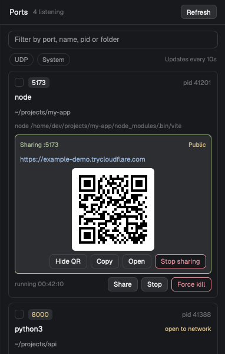

# Herdr Port Manager

A side panel for the [Herdr](https://herdr.dev) app that lists every port your computer is
listening on, shows which process holds it (name, pid, folder, command line), and lets you stop one
process or several at once, politely (Stop) or not (Force kill). It can also share a port with your
phone or another computer, with one click and a QR code.



## Install

In the Herdr app, ask its agent:

```
Read ~/.config/herdr-app/AGENTS.md, then add this mod: https://github.com/unickhow/herdr-port-manager
```

The agent copies `mods/port-manager/` into your Herdr folder and docks it on the right. Or clone the repo
and point the agent at the local folder:

```sh
git clone https://github.com/unickhow/herdr-port-manager.git
```

```
Read ~/.config/herdr-app/AGENTS.md, then add the mod in the folder you cloned it to
```

Requires `python3` (the macOS one is fine). Details for the agent are in [RECIPE.md](RECIPE.md).

To remove it, delete `~/.config/herdr-app/mods/port-manager/`, stop any shares first, and optionally delete
`~/.cache/herdr-port-manager/`.

## Updating

Herdr does not update mods you added: the folder in `~/.config/herdr-app/mods/port-manager/` is your
copy and stays as it is until you replace it. To update:

1. Optional: stop any shares first. Shares started by an older version keep running and the new
   version still lists them (with a Stop button), but it cannot stop them for you on its own.
2. Ask the Herdr agent to replace the mod with the new version, giving it the same GitHub link or
   cloned folder as for the install, and tell it to **replace the existing `port-manager` folder**,
   not add a second copy (its default is to rename rather than overwrite).
3. Replace the whole folder, never single files: the panel and the script are versioned together.
   If they get out of step the panel shows a "Mixed versions" warning at the top.

Your settings and docking are kept. Shares and the state in `~/.cache/herdr-port-manager/` carry over.

## Using it

- Type in the search box to filter by port, name, pid or folder. **UDP** and **System** show the
  hidden ones.
- **Stop** asks the process to quit (SIGTERM). **Force kill** ends it immediately (SIGKILL). Tick
  several cards to stop them together. Everything asks first and names what will be stopped.
- A yellow port chip means that port is open to the network, not only this computer.
- The list updates every 10 seconds.

## Share a port with other devices

**Share** on a card gives two ways to open that port from a phone or another computer, like VS
Code's port forwarding:

| | Cloudflare Tunnel | Dev Tunnels |
|---|---|---|
| Who can open it | anyone with the link | only you, signed in |
| Account | none | GitHub or Microsoft |
| URL | new each time | can stay the same |
| Install | `brew install cloudflared` | `brew install --cask devtunnel` |

Both are **optional** and are never installed for you: if one is missing the panel shows
"Not installed" and copies the install command for you to run. Once installed it is one click:
**Start sharing**, wait a few seconds, and the link appears on the card with a QR code to scan, plus
**Copy**, **Open** and **Stop sharing**.

- Dev Tunnels needs a one-time sign-in; the card shows a **Sign in** button when it is needed.
- A share is tied to the process you chose. It keeps running when you close the panel or Herdr,
  until you press **Stop sharing** or that process has been gone (or stopped holding the port) for
  about 15 seconds; then it stops on its own and the panel says "Stopped sharing :PORT: service
  exited", with **Try again** and **Dismiss**.
- Sharing is refused, with the reason, when nothing is listening on the port or the listener is no
  longer the process you chose.
- A share started by an older version of the mod is still listed and **Stop sharing** stops it (it
  does not stop on its own). If the panel cannot tell whether a share is still running, it keeps it
  listed with a warning instead of forgetting it. A share started by a newer version is shown at the
  top with a note to update the mod; this version never stops or removes it.
- If another panel or the command line restarted a share after you saw it, its **Stop sharing** and
  **Dismiss** refuse with "this share was restarted since it was shown" instead of stopping the new
  one, and the list reloads.
- Some dev servers (Vite) reject unknown host names. Cloudflare works because the Host header is
  rewritten to `localhost`. With Dev Tunnels, allow `*.devtunnels.ms` in the server's allowed hosts if
  you see "Blocked request".

## Privacy and safety

- The panel itself makes no network requests. It runs `lsof` and `ps` and reads nothing else.
- Sharing sends traffic through Cloudflare's or Microsoft's servers, and only starts when you press
  Start sharing. A Cloudflare link is public to anyone who has it: don't share a dev server with
  logged-in sessions or admin pages.
- Only your own processes can be stopped. When you tick a card or press Stop / Force kill, the panel
  remembers that process as you saw it (pid, port, start time), and exactly that is confirmed and
  sent. If a refresh shows another process behind that pid, or it no longer holds that port, it is
  deselected and the bar says so. Immediately before each signal, the pid is checked again for that
  start time, owner and port; otherwise it is not signalled.
- A tunnel is only signalled after checking that its pid is still the tunnel's supervisor (exact
  command line and recorded start time), and it is forgotten only once it is gone; a tunnel that
  will not stop stays listed with the reason. Starts and stops of shares never overlap; a second
  one waits up to 10 seconds, then says another is in progress. A lock held by each tunnel's
  supervisor for its whole life keeps two supervisors of this version from running for one share,
  even when a start is interrupted.
- Two limits remain: start times have one-second resolution, and a check and its signal are two
  steps, so a tiny window between them remains.
- Full command lines are shown; they can include tokens passed as arguments. They never leave your
  computer, but keep them out of screenshots.
- Tunnel state and logs are in `~/.cache/herdr-port-manager/` (private to your user). Each log is
  capped at about 30 KB by the tunnel's supervisor, whether or not the panel is open.

## Limitations

- macOS only (relies on macOS `lsof` and `ps`). Tested on Herdr 0.1.13.
- Other users' and root processes may not appear and cannot be stopped.
- Lists listening TCP and (optionally) bound UDP, not outgoing connections.
- The Dev Tunnels link detection follows its documented output but has not been confirmed against a
  real run; Cloudflare has.
- It refreshes every 10 seconds (about 0.15 s of CPU each) even while the panel is hidden.

## Files

```
RECIPE.md                           what the mod looks like and how it works (the brief Herdr's agent builds from)
preview.png                         screenshot
mods/port-manager/main.js           the panel
mods/port-manager/pin.js            what the panel remembers of a process you picked (pure functions)
mods/port-manager/port-manager.py   lists ports, stops processes, runs tunnels (stdlib Python)
mods/port-manager/qr.py             QR code encoder for the share link (stdlib Python)
mods/port-manager/mod.json          where it docks
mods/port-manager/port-manager.svg  icon for an optional toolbar button
```

## License

[MIT](LICENSE)
